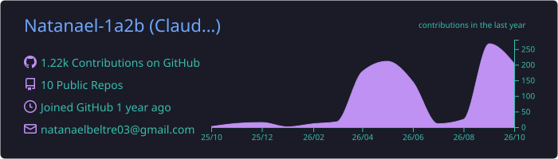
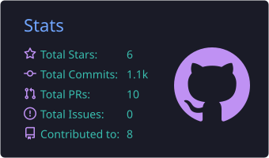
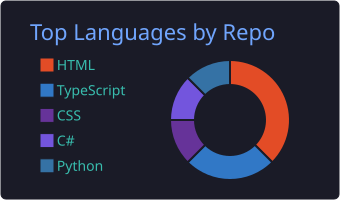
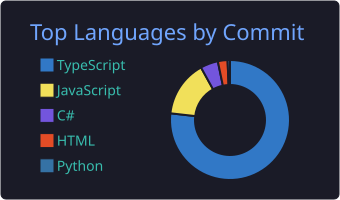

  

  

    <strong>Full Stack & Cloud Engineer</strong> enfocado en construir software escalable, arquitecturas limpias y soluciones potenciadas con <strong>Agentes de IA</strong>.
  

  

    
    &nbsp;
    
    &nbsp;
    
    &nbsp;
    
  

   

  <!-- TECH STACK -->
  <h3>🛠️ Tech Stack</h3>

  

    
     
    
  

   

  <!-- PROYECTOS DESTACADOS -->
  <h3>🚀 Proyectos Destacados</h3>

  

    
    &nbsp;
    
    &nbsp;
    
     
    
    &nbsp;
    
  

   

  <!-- GITHUB ANALYTICS -->
  <h3>📊 Actividad & Métricas</h3>

  

    
  

  

    
    
  

  

    
    
  

